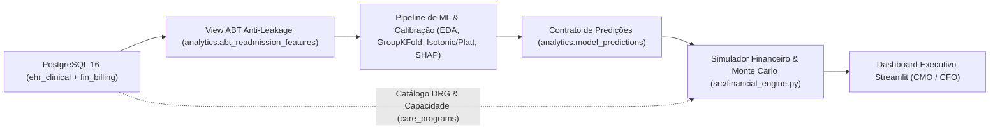

# Project Aegis — Healthcare Risk & ROI Engine (DACH Market)

> **Motor de Decisão Clínica e Financeira para Redução de Reinternações Evitáveis em 30 Dias sob Regras G-DRG / SwissDRG**

Project Aegis é uma plataforma analítica *end-to-end* projetada para hospitais de médio e grande porte da região **DACH (Alemanha, Áustria e Suíça)**. O sistema conecta dados clínicos longitudinais de prontuário eletrônico (EHR) e faturamento hospitalar DRG a modelos preditivos calibrados e a um motor de simulação econômico-operacional, respondendo à pergunta central da diretoria médica e financeira (**CMO & CFO**):

> **Quais pacientes de alto risco devem receber programas de transição de cuidados pós-alta, respeitando a capacidade operacional das equipes e maximizando a economia líquida (*Net Savings*) e o ROI hospitalar?**

---

## 1. Visão Geral e Problema de Negócio (Value-Based Healthcare no Mercado DACH)

### O impacto financeiro das reinternações e o *Fallzusammenführung* (§ 2 FPV)
Nos sistemas de pagamento prospectivo por caso da região DACH — **G-DRG** (*German Diagnosis Related Groups*) e **SwissDRG** — o hospital recebe um valor fixo por episódio de internação baseado no peso relativo do DRG multiplicado pelo valor base regional (*Basisfallwert*, tipicamente em torno de **€4.200,00** na Alemanha).

Quando um paciente recebe alta e retorna ao mesmo hospital dentro de uma janela crítica (em geral **até 30 dias**, dentro da mesma *Major Diagnostic Category* ou sequência clínica prevista pela legislação), aplica-se a regra de **consolidação de casos (*Fallzusammenführung* — § 2 FPV / *Fallpauschalenvereinbarung*)**:
- As duas internações são fundidas administrativamente em um único caso faturável.
- **O hospital perde integralmente o segundo reembolso DRG**, mas continua absorvendo 100% dos custos assistenciais, insumos, hotelaria e equipe médica da reinternação.
- Além da perda direta de receita, cada leito ocupado por uma reinternação evitável reduz a capacidade de absorver internações eletivas de maior margem (*bed-day opportunity cost*).

### O dilema econômico-operacional da transição de cuidados
Programas de cuidado transicional pós-alta — como telemonitoramento (*Remote Patient Telemonitoring*), visitas domiciliares de enfermagem (*Post-Discharge Nurse Home Visits*), reconciliação medicamentosa (*Clinical Pharmacy Med Reconciliation*) e gestão intensiva de casos — reduzem significativamente a taxa de retorno em 30 dias, mas possuem **custo unitário por paciente** e **restrição estrita de vagas mensais (`monthly_capacity_slots`) e horas clínicas (`staff_hours_per_patient`)**:
- **Aplicar em todos os pacientes (*Treat All*):** dilui o impacto clínico em pacientes de baixo risco, estoura a capacidade das equipes e gera **prejuízo líquido (ROI negativo)**.
- **Aplicar em poucos pacientes ou por heurística simples:** desperdiça margem financeira recuperável, sobrecarrega leitos hospitalares e compromete indicadores assistenciais de qualidade.
- **Decisão orientada por risco calibrado e ROI (*Expected Value Optimization*):** combina probabilidades reais de reinternação com o risco financeiro específico de cada DRG e as restrições de capacidade do hospital.

---

## 2. Arquitetura End-to-End

A plataforma separa estritamente a camada transacional/clínica, a extração de *features* livre de vazamento temporal (*anti-data leakage*), a modelagem preditiva calibrada, o motor financeiro estocástico e a camada de decisão executiva:



### Princípios Arquiteturais
1. **Zero Data Leakage por Construção:** nenhuma informação gerada após a alta (custos reais apurados, desfecho futuro de óbito ou exames laboratoriais coletados antes da alta mas liberados depois) entra como *feature* na ABT.
2. **Contrato Desacoplado via Banco de Dados:** o pipeline de Ciência de Dados consome `analytics.abt_readmission_features` e persiste predições versionadas em `analytics.model_predictions`, permitindo que múltiplos modelos e calibrações sejam comparados diretamente no simulador financeiro.
3. **Alinhamento Clínico-Financeiro:** o corte de decisão não é apenas um *threshold* estatístico arbitrário (ex.: `0.50`), mas o ponto ótimo que maximiza *Net Savings* e respeita `monthly_capacity_slots`.

---

## 3. O que já foi implementado (Fases 1 e 2 — Concluídas)

### Fase 1 — Infraestrutura Docker, PostgreSQL 16 e Modelagem Relacional DACH

#### Infraestrutura Local (`docker-compose.yml`, `.env.example`, `requirements.txt`)
- Container `aegis_hospital_db` baseado em `postgres:16-alpine`, expondo a porta **`5433`** no host mapeada para `5432` interna (evitando conflitos com instâncias locais na porta `5432`).
- Volume persistente `aegis_hospital_pgdata`, rede isolada `aegis_hospital_network`, *healthcheck* automático via `pg_isready` e inicialização declarativa dos scripts em `./sql` via `/docker-entrypoint-initdb.d`.
- Ambiente Python gerenciado com dependências base (`SQLAlchemy>=2.0.0`, `psycopg2-binary>=2.9.9`, `numpy>=1.26.0`) e configurações centralizadas em [`src/config.py`](src/config.py).

#### Modelagem Relacional DACH (`sql/01_init_schema.sql`)
Banco `hospital_aegis` estruturado em **3 schemas** e **9 tabelas** com chaves estrangeiras compostas `(encounter_id, patient_id)`, *check constraints* clínicas e índices compostos para consultas longitudinais:

- **Schema `ehr_clinical` (Prontuário Eletrônico):**
  - `patients`: cadastro mestre (MPI) com cobertura DACH (`GKV`, `PKV`, `BG`, `SELF_PAY`) e **Determinantes Sociais de Saúde (SDOH)** — *Pflegegrad* (`nursing_care_level` de `0` a `5`), `lives_alone`, `distance_to_hospital_km` e `has_primary_care_physician`. Contém colunas administrativas de óbito (`is_deceased`, `deceased_date`) mantidas fora da ABT.
  - `encounters`: internações longitudinais (`INPATIENT`, `ICU`, etc.), histórico encadeado (`previous_encounter_id`), diagnósticos ICD-10-GM e *snapshot* temporal de comorbidades (`charlson_score_at_admit`).
  - `vital_signs`: sinais vitais durante a internação (FC, PAS/PAD, FR, SpO₂, temperatura) com cálculo do escore de alerta precoce **NEWS2** (`news2_score` de `0` a `20`).
  - `lab_results`: painel laboratorial padronizado por códigos **LOINC** com separação explícita entre `collected_datetime` e `resulted_datetime`.
  - `medications`: prescrições hospitalares e de alta (*RxNorm*), com sinalização de fármacos de alto risco (`is_high_risk`, ex.: anticoagulantes, insulina, opioides, diuréticos de alça, digitálicos).
- **Schema `fin_billing` (Economia Hospitalar DACH):**
  - `drg_costs`: catálogo **G-DRG** em `EUR` com `relative_weight`, *Basisfallwert* (`base_rate = 4200.00`), limites de permanência (`ugvd_days`, `geometric_mean_los`, `ogvd_days`), `standard_cost`, `base_reimbursement` e janela de consolidação de **30 dias** (`consolidation_window_days`).
  - `care_programs`: catálogo de programas de transição com custo unitário (`intervention_cost`), restrição operacional (`monthly_capacity_slots`, `staff_hours_per_patient`) e parâmetros de eficácia para simulação estocástica (`expected_readmission_reduction`, `effectiveness_ci_low`, `effectiveness_ci_high`).
  - `encounter_billing`: faturamento pós-alta por episódio, capturando o impacto direto de *Fallzusammenführung* (`is_case_consolidated`, `claim_status = 'CONSOLIDATED'`, `drg_consolidation_loss`).
- **Schema `analytics` (Camada Analítica e Contrato ML):**
  - `model_predictions`: tabela versionada (`UNIQUE (encounter_id, model_version)`) para gravar `split_name` (`train`, `val`, `test`, `oot`), `y_true`, `y_prob` e `estimated_readmission_cost`.

---

### Fase 2 — Gerador de Dados Sintéticos, ABT Anti-Leakage e Dicionário de Dados

#### Gerador de Dados Sintéticos DACH (`src/seed_database.py`)
Script reproduzível (`seed=42`) que popula o banco com uma coorte hospitalar clinicamente coerente de 2 anos (`2024-01-01` a `2025-12-31`), em **cenário baseline limpo** (`care_program_id = NULL`, sem *treatment confounding*):
- **15.000 internações** distribuídas entre **8.250 pacientes**, cobrindo **23 G-DRGs** (clínicos e cirúrgicos, ex.: Insuficiência Cardíaca `F62A/B/C`, Sepse `T60A/B`, DPOC `E65A/B`, Pneumonia `E77A/B`, Insuficiência Renal `L60A/B`, AVC `B70A/B`, Artroplastia `I47A/B`) e **5 programas de transição** (`TCM-30`, `TELE-HF`, `HOME-RN`, `MED-REC`, `ICM-CRIT`).
- **38.885 aferições de sinais vitais** com escore NEWS2 coerente com a gravidade clínica e evolução até a alta.
- **223.340 exames laboratoriais** com realismo clínico e **missingness estrutural MNAR (*Missing Not At Random*)**: por exemplo, o biomarcador **BNP** (`30934-4`) está presente em **~85,9%** das internações de Cardiologia contra apenas **~6,2%** em Ortopedia; além disso, **~6%** dos exames coletados próximo à alta possuem `resulted_datetime > discharge_datetime` (laudo liberado apenas após a alta).
- **75.104 prescrições medicamentosas** hospitalares e de alta.
- **1.650 casos consolidados por *Fallzusammenführung***, acumulando aproximadamente **€10,13 milhões** em perdas diretas de reembolso DRG na base histórica.

#### View ABT Anti-Data Leakage (`sql/02_feature_extraction.sql`)
A view `analytics.abt_readmission_features` consolida toda a jornada do paciente até o instante exato da alta hospitalar:
- **Volumetria e target:** **14.361 internações elegíveis × 67 colunas**, com taxa observada de reinternação em 30 dias (`target_readmitted_30d`) de **12,34%**.
- **Filtros de elegibilidade da coorte:** exclui óbitos intra-hospitalares (`discharge_disposition <> 'EXPIRED'`) e exclui altas nos últimos 30 dias da base (elimina censura à direita na janela de acompanhamento).
- **Split temporal sugerido (`recommended_split`):** separa os últimos ~6 meses elegíveis (`discharge_datetime >= max_admit_datetime - INTERVAL '210 days'`) como conjunto `test` (*out-of-time*) e o restante como `train`.
- **Window Functions anti-leakage:**
  - Histórico longitudinal (`admissions_last_6m` com janela `RANGE BETWEEN INTERVAL '180 days' PRECEDING AND INTERVAL '1 second' PRECEDING`, `prior_admissions_total`, `days_since_last_discharge`).
  - Últimos sinais vitais pré-alta (`recorded_datetime <= discharge_datetime`) e contagem de episódios de instabilidade (`news2_score >= 5`) nas últimas 24 horas.
  - Últimos exames por biomarcador (`last_hemoglobin`, `last_sodium`, `last_creatinine`, `last_wbc`, `last_glucose`, `last_potassium`, `last_bnp`) considerando **exclusivamente `resulted_datetime <= discharge_datetime`**; exames coletados mas não liberados até a alta ficam isolados na contagem `pending_labs_at_discharge_count`.
- **Isolamento de colunas pós-alta:** métricas realizadas após o episódio índice são explicitamente prefixadas com `eval_*` (`eval_index_actual_cost`, `eval_estimated_readmission_cost`, `eval_realized_consolidation_loss`, `eval_realized_next_encounter_cost`) para impedir uso acidental em `X_train`.

#### Documentação Técnica (`docs/DATA_DICTIONARY.md`)
Dicionário de dados completo documentando todos os schemas, tabelas, restrições de integridade, os 4 grupos de colunas da ABT (Identificadores/Split, *Features* válidas na alta, Avaliação `eval_*` e Target), o contrato de `analytics.model_predictions` e recomendações de modelagem para MNAR e prevenção de *leakage*.

---

## 4. Roadmap — O que será feito a seguir (Fases 3 a 6)

- [x] **Fase 1:** Infraestrutura Docker / PostgreSQL 16 e DDL completo DACH (`sql/01_init_schema.sql`).
- [x] **Fase 2:** Gerador sintético DACH (`src/seed_database.py`), View ABT anti-leakage (`sql/02_feature_extraction.sql`) e Dicionário de Dados (`docs/DATA_DICTIONARY.md`).
- [ ] **Fase 3 — Ciência de Dados Clínica & Modelagem Preditiva *(Manual / Data Science)*:**
  - Análise exploratória (EDA) e tratamento de *missingness* estrutural MNAR (ex.: indicadores clínicos para exames seletivos como BNP).
  - *Feature engineering* clínico e validação cruzada respeitando ordem temporal e agrupamento por paciente (`recommended_split` + `GroupKFold` em `patient_id`).
  - Treinamento comparativo (ex.: Regressão Logística, XGBoost/LightGBM) para risco de reinternação em 30 dias.
  - **Calibração de probabilidades** (*Brier Score*, *Calibration Curve*, *Isotonic Regression* & *Platt Scaling*) — etapa crítica para que `y_prob` represente risco real utilizável em valor esperado financeiro.
  - Explicabilidade clínica global e local com **SHAP** e gravação das versões de modelo no contrato `analytics.model_predictions`.
- [ ] **Fase 4 — Motor de Simulação Financeira & Otimização Operacional (`src/financial_engine.py`):**
  - Cálculo de *Net Savings*, ROI, *Number Needed to Treat* (**NNT**) e *break-even effectiveness* por faixa/threshold de risco.
  - Otimização de fronteira sob restrição de capacidade mensal (`monthly_capacity_slots` e carga horária clínica) e incorporação do custo de oportunidade de leito-dia (*bed-day backfill margin*, padrão **€450,00/dia**).
  - **Simulação estocástica de Monte Carlo** amostrando a incerteza de eficácia dos programas (`effectiveness_ci_low` a `effectiveness_ci_high`) para quantificar intervalos de confiança do ROI (P5, mediana, P95).
- [ ] **Fase 5 — Qualidade & Testes Automatizados (`tests/`):**
  - Suíte `pytest` cobrindo testes unitários determinísticos das fórmulas do motor financeiro (NNT, *break-even*, restrição de capacidade, casos extremos) e testes de contrato/integridade do banco PostgreSQL e da view `analytics.abt_readmission_features`.
- [ ] **Fase 6 — Executive Decision Dashboard (`app/`):**
  - Aplicação interativa em **Streamlit** (interface 100% em inglês, padrão executivo DACH) voltada a **CMO & CFO**, permitindo simular *thresholds*, comparar políticas de alocação (*Treat All* vs *Risk Threshold* vs *Capacity-Constrained Optimal*), visualizar análise de sensibilidade e demonstrar o impacto econômico direto da calibração de probabilidades.

---

## 5. Estrutura do Repositório

```text
project-aegis/
├── .env.example                 # Variáveis de ambiente padrão (PostgreSQL porta 5433)
├── .gitignore
├── docker-compose.yml           # Orquestração PostgreSQL 16 (aegis_hospital_db)
├── requirements.txt             # Dependências Python do ambiente de dados
├── README.md                    # Documentação executiva e técnica do projeto
├── docs/
│   └── DATA_DICTIONARY.md       # Dicionário completo de schemas, ABT e contrato ML
├── sql/
│   ├── 01_init_schema.sql       # DDL dos schemas ehr_clinical, fin_billing e analytics
│   └── 02_feature_extraction.sql# View analytics.abt_readmission_features (anti-leakage)
└── src/
    ├── __init__.py
    ├── config.py                # Configurações de banco e parâmetros DACH (EUR, €4.200)
    └── seed_database.py         # Gerador de 15.000 internações DACH sintéticas
```

*(As pastas `notebooks/`, `tests/`, `app/` e o módulo `src/financial_engine.py` serão adicionados nas Fases 3 a 6 conforme o roadmap.)*

---

## 6. Quickstart (WSL Ubuntu & Docker)

### Pré-requisitos
- **Docker** e **Docker Compose** ativos (ex.: Docker Desktop integrado ao WSL2 ou Docker Engine no Ubuntu).
- **Python 3.11+** no WSL Ubuntu.

### 1. Subir o banco PostgreSQL 16
Na raiz do repositório (`/home/rafaelwhoa/projects/project-aegis`), opcionalmente copie `.env.example` para `.env` e inicie o container:

```bash
cp -n .env.example .env
docker compose up -d
```

Verifique se o container `aegis_hospital_db` está saudável (`healthy`):

```bash
docker compose ps
```

> Os scripts `sql/01_init_schema.sql` e `sql/02_feature_extraction.sql` são executados automaticamente na primeira inicialização do volume `aegis_hospital_pgdata`.

### 2. Criar/ativar o ambiente virtual Python (`.venv`) e instalar dependências
```bash
python3 -m venv .venv
source .venv/bin/activate
pip install --upgrade pip
pip install -r requirements.txt
```

### 3. Popular o banco com o dataset sintético DACH
```bash
python -m src.seed_database
```

Opções disponíveis via CLI:
```bash
python -m src.seed_database --encounters 15000 --seed 42
```

### 4. Validar a View ABT (`analytics.abt_readmission_features`)
Consulte diretamente via `psql` dentro do container para inspecionar a coorte elegível, o *split* temporal e a taxa de reinternação em 30 dias:

```bash
docker exec -it aegis_hospital_db psql -U aegis_admin -d hospital_aegis -c "
SELECT
    recommended_split,
    COUNT(*) AS eligible_encounters,
    ROUND(AVG(target_readmitted_30d) * 100, 2) AS readmission_rate_pct,
    ROUND(SUM(eval_realized_consolidation_loss), 2) AS realized_consolidation_loss_eur
FROM analytics.abt_readmission_features
GROUP BY recommended_split
ORDER BY recommended_split;
"
```

---

## Referência Técnica
Para detalhes completos de cada coluna, regras de *missingness* (MNAR) e contrato de saída para o pipeline de Machine Learning, consulte o [Dicionário de Dados](docs/DATA_DICTIONARY.md).
