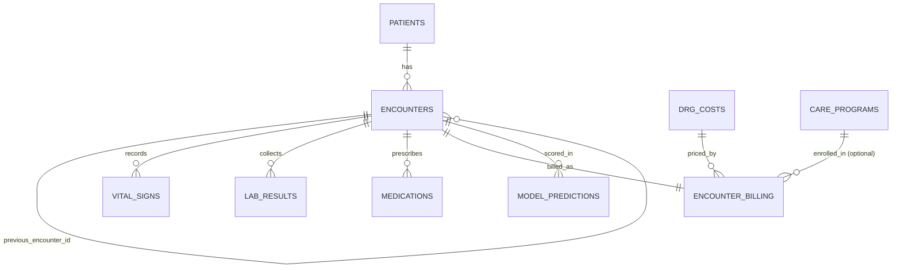

# Dicionário de Dados — Project Aegis (Healthcare Risk & ROI Engine)

> **Banco de Dados:** `hospital_aegis` (PostgreSQL 16, porta `5433`)  
> **Contexto:** Hospital europeu padrão **DACH** (Alemanha / Áustria / Suíça — G-DRG, moeda `EUR`, *Basisfallwert* = €4.200,00, regra de consolidação de casos *Fallzusammenführung* em 30 dias).

---

## 1. Visão Geral dos Schemas e Relacionamentos

| Schema | Propósito | Objetos |
| :--- | :--- | :--- |
| `ehr_clinical` | Prontuário Eletrônico (EHR) e dados assistenciais | `patients`, `encounters`, `vital_signs`, `lab_results`, `medications` |
| `fin_billing` | Catálogo G-DRG, faturamento hospitalar e programas de transição | `drg_costs`, `care_programs`, `encounter_billing` |
| `analytics` | Camada analítica para ML (ABT) e contrato de saída de predições | `abt_readmission_features` *(VIEW)*, `model_predictions` *(TABLE)* |

---

## 2. Schema `ehr_clinical`

### 2.1. `ehr_clinical.patients`
Cadastro mestre de pacientes (Master Patient Index) com determinantes sociais de saúde (SDOH).

| Coluna | Tipo | Nulo | Restrições / Valores | Descrição |
| :--- | :--- | :---: | :--- | :--- |
| `patient_id` | `BIGINT` | Não | `PK`, Identity | Identificador único interno do paciente. |
| `mrn` | `VARCHAR(32)` | Não | `UNIQUE` | Medical Record Number (`PAT-0000001`). |
| `first_name` | `VARCHAR(100)` | Não | — | Primeiro nome do paciente. |
| `last_name` | `VARCHAR(100)` | Não | — | Sobrenome do paciente. |
| `birth_date` | `DATE` | Não | — | Data de nascimento. |
| `sex` | `VARCHAR(16)` | Não | `M`, `F`, `OTHER`, `UNKNOWN` | Sexo biológico registrado. |
| `postal_code` | `VARCHAR(15)` | Sim | — | Código postal (padrão 5 dígitos DACH). |
| `payer_type` | `VARCHAR(20)` | Não | `GKV`, `PKV`, `BG`, `SELF_PAY` | Tipo de seguro saúde (`GKV` = público estatutário, `PKV` = privado, `BG` = acidente de trabalho). |
| `lives_alone` | `BOOLEAN` | Não | Default `FALSE` | SDOH: indica se o paciente mora sozinho. |
| `nursing_care_level` | `SMALLINT` | Não | `0` a `5` | SDOH: grau de dependência de enfermagem (*Pflegegrad* 0 = independente, 5 = dependência máxima). |
| `distance_to_hospital_km` | `NUMERIC(6,1)` | Não | `>= 0` | SDOH: distância estimada da residência ao hospital (km). |
| `has_primary_care_physician` | `BOOLEAN` | Não | Default `TRUE` | SDOH: possui médico de família (*Hausarzt*) vinculado. |
| `is_deceased` | `BOOLEAN` | Não | Default `FALSE` | **Apenas administrativo.** Não usar como feature (risco de leakage futuro). |
| `deceased_date` | `DATE` | Sim | `>= birth_date` | **Apenas administrativo.** Data do óbito (se aplicável). |
| `created_at` | `TIMESTAMPTZ` | Não | Default `NOW()` | Timestamp de criação do registro. |
| `updated_at` | `TIMESTAMPTZ` | Não | Default `NOW()` | Timestamp da última atualização (trigger automático). |

---

### 2.2. `ehr_clinical.encounters`
Registro longitudinal de internações hospitalares.

| Coluna | Tipo | Nulo | Restrições / Valores | Descrição |
| :--- | :--- | :---: | :--- | :--- |
| `encounter_id` | `BIGINT` | Não | `PK`, Identity | Identificador único da internação. |
| `patient_id` | `BIGINT` | Não | `FK -> patients(patient_id)` | Paciente internado. Possui `UNIQUE (encounter_id, patient_id)`. |
| `previous_encounter_id` | `BIGINT` | Sim | `FK -> encounters(encounter_id)` | Referência à internação imediatamente anterior do mesmo paciente. |
| `encounter_number` | `VARCHAR(40)` | Não | `UNIQUE` | Número administrativo do caso (`FALL-2024-000001`). |
| `encounter_type` | `VARCHAR(20)` | Não | `INPATIENT`, `ICU`, `EMERGENCY`, `OBSERVATION`, `OUTPATIENT` | Modalidade da internação (`INPATIENT` ou `ICU` na base atual). |
| `admit_datetime` | `TIMESTAMPTZ` | Não | — | Data e hora da admissão hospitalar (UTC). |
| `discharge_datetime` | `TIMESTAMPTZ` | Sim | `>= admit_datetime` | Data e hora da alta hospitalar (UTC). |
| `admission_source` | `VARCHAR(30)` | Não | `EMERGENCY`, `ELECTIVE`, `URGENT`, `TRANSFER`, `REFERRAL`, `NEWBORN` | Origem da admissão. |
| `discharge_disposition` | `VARCHAR(30)` | Sim | `HOME`, `HOME_HEALTH`, `SNF`, `REHAB`, `TRANSFER`, `AMA`, `HOSPICE`, `EXPIRED` | Destino na alta (`AMA` = alta a pedido, `SNF` = casa de repouso/enfermagem, `EXPIRED` = óbito). |
| `department` | `VARCHAR(60)` | Não | — | Especialidade/ala clínica (`Cardiology`, `Internal Medicine`, `Pulmonology`, etc.). |
| `primary_diagnosis_code` | `VARCHAR(16)` | Não | ICD-10-GM | Código do diagnóstico principal na internação. |
| `primary_diagnosis_desc` | `VARCHAR(255)` | Sim | — | Descrição do diagnóstico principal. |
| `secondary_diagnosis_codes` | `TEXT[]` | Não | Default `'{}'` | Array de códigos ICD-10 secundários/comorbidades. |
| `charlson_score_at_admit` | `SMALLINT` | Não | `>= 0` | **Snapshot temporal** do Charlson Comorbidity Index no momento da admissão (evolui sem vazar futuro). |
| `attending_physician_id` | `VARCHAR(32)` | Sim | — | Identificador do médico assistente (`ARZT-100` a `ARZT-349`). |
| `created_at` / `updated_at` | `TIMESTAMPTZ` | Não | Default `NOW()` | Auditoria temporal. |

---

### 2.3. `ehr_clinical.vital_signs`
Sinais vitais registrados ao longo da internação (admissão, meio da estadia e pré-alta).

| Coluna | Tipo | Nulo | Restrições / Valores | Descrição |
| :--- | :--- | :---: | :--- | :--- |
| `vital_sign_id` | `BIGINT` | Não | `PK`, Identity | Identificador único da medição. |
| `encounter_id` | `BIGINT` | Não | `FK composta -> encounters` | Internação associada. |
| `patient_id` | `BIGINT` | Não | `FK -> patients` | Paciente associado. |
| `recorded_datetime` | `TIMESTAMPTZ` | Não | — | Data e hora da aferição. |
| `heart_rate_bpm` | `SMALLINT` | Não | `25` a `240` | Frequência cardíaca (bpm). |
| `systolic_bp_mmhg` | `SMALLINT` | Não | `50` a `260` | Pressão arterial sistólica (mmHg). |
| `diastolic_bp_mmhg` | `SMALLINT` | Não | `25` a `160` | Pressão arterial diastólica (mmHg). |
| `respiratory_rate_rpm` | `SMALLINT` | Não | `6` a `60` | Frequência respiratória (irpm). |
| `spo2_pct` | `NUMERIC(4,1)` | Não | `50.0` a `100.0` | Saturação periférica de oxigênio (%). |
| `temperature_c` | `NUMERIC(4,1)` | Não | `32.0` a `43.0` | Temperatura corporal (°C). |
| `news2_score` | `SMALLINT` | Não | `0` a `20` | Escore clínico de alerta precoce **NEWS2** calculado na aferição (`>= 5` indica instabilidade). |
| `created_at` | `TIMESTAMPTZ` | Não | Default `NOW()` | Auditoria temporal. |

---

### 2.4. `ehr_clinical.lab_results`
Resultados laboratoriais com controle de tempo de coleta e liberação.

| Coluna | Tipo | Nulo | Restrições / Valores | Descrição |
| :--- | :--- | :---: | :--- | :--- |
| `lab_result_id` | `BIGINT` | Não | `PK`, Identity | Identificador único do exame. |
| `encounter_id` | `BIGINT` | Não | `FK composta -> encounters` | Internação associada. |
| `patient_id` | `BIGINT` | Não | `FK -> patients` | Paciente associado. |
| `loinc_code` | `VARCHAR(20)` | Não | LOINC | Código padrão do exame (`718-7` Hb, `2951-2` Na, `2160-0` Creat, `6690-2` WBC, `2345-7` Glucose, `2823-3` K, `30934-4` BNP). |
| `test_name` | `VARCHAR(120)` | Não | — | Nome do exame laboratorial. |
| `test_category` | `VARCHAR(50)` | Sim | — | Categoria (`HEMATOLOGY`, `CHEMISTRY`, `CARDIAC`). |
| `result_value_num` | `NUMERIC(12,4)` | Sim | Valor ou texto obrigatório | Resultado numérico do exame. |
| `result_value_text` | `VARCHAR(100)` | Sim | — | Resultado qualitativo (quando aplicável). |
| `unit` | `VARCHAR(30)` | Sim | — | Unidade de medida (`g/dL`, `mEq/L`, `mg/dL`, `pg/mL`, etc.). |
| `reference_range_low` | `NUMERIC(12,4)` | Sim | — | Limite inferior de normalidade. |
| `reference_range_high` | `NUMERIC(12,4)` | Sim | — | Limite superior de normalidade. |
| `abnormal_flag` | `VARCHAR(20)` | Não | `NORMAL`, `LOW`, `HIGH`, `CRITICAL_LOW`, `CRITICAL_HIGH`, `ABNORMAL` | Classificação de anormalidade. |
| `collected_datetime` | `TIMESTAMPTZ` | Não | — | Momento da coleta da amostra. |
| `resulted_datetime` | `TIMESTAMPTZ` | Sim | `>= collected_datetime` | Momento da liberação do laudo (se `> discharge_datetime`, o exame estava **pendente na alta**). |
| `created_at` | `TIMESTAMPTZ` | Não | Default `NOW()` | Auditoria temporal. |

---

### 2.5. `ehr_clinical.medications`
Prescrições medicamentosas hospitalares e de alta.

| Coluna | Tipo | Nulo | Restrições / Valores | Descrição |
| :--- | :--- | :---: | :--- | :--- |
| `medication_id` | `BIGINT` | Não | `PK`, Identity | Identificador único da prescrição. |
| `encounter_id` | `BIGINT` | Não | `FK composta -> encounters` | Internação associada. |
| `patient_id` | `BIGINT` | Não | `FK -> patients` | Paciente associado. |
| `rxnorm_code` | `VARCHAR(20)` | Sim | RxNorm | Código padronizado do fármaco. |
| `medication_name` | `VARCHAR(150)` | Não | — | Nome do medicamento (ex: `Phenprocoumon`, `Torasemide`, `Insulin Glargine`). |
| `therapeutic_class` | `VARCHAR(80)` | Sim | — | Classe terapêutica. |
| `dosage` | `VARCHAR(60)` | Não | — | Dose prescrita. |
| `route` | `VARCHAR(30)` | Não | — | Via de administração (`ORAL`, `IV`, `SC`, `INHALATION`). |
| `frequency` | `VARCHAR(50)` | Não | — | Posologia (`QD`, `BID`, `Q6H`, `Q24H`). |
| `order_type` | `VARCHAR(20)` | Não | `INPATIENT`, `DISCHARGE`, `HOME_MED` | Contexto da prescrição. |
| `is_high_risk` | `BOOLEAN` | Não | Default `FALSE` | Indica fármaco de alto risco de evento adverso/readmissão (anticoagulantes, insulina, opioides, diuréticos de alça, digitálicos). |
| `start_datetime` | `TIMESTAMPTZ` | Não | — | Início da prescrição. |
| `end_datetime` | `TIMESTAMPTZ` | Sim | `>= start_datetime` | Término previsto da prescrição. |
| `prescribing_physician_id` | `VARCHAR(32)` | Sim | — | Médico prescritor. |
| `created_at` | `TIMESTAMPTZ` | Não | Default `NOW()` | Auditoria temporal. |

---

## 3. Schema `fin_billing`

### 3.1. `fin_billing.drg_costs`
Tabela de referência **G-DRG** com pesos relativos, limites de permanência e reembolso base.

| Coluna | Tipo | Nulo | Restrições / Valores | Descrição |
| :--- | :--- | :---: | :--- | :--- |
| `drg_code` | `VARCHAR(16)` | Não | `PK` | Código G-DRG (ex: `F62A`, `T60A`, `I47B`). |
| `drg_description` | `VARCHAR(255)` | Não | — | Descrição oficial do agrupamento DRG. |
| `mdc_code` | `VARCHAR(16)` | Não | — | Major Diagnostic Category (usada na regra de *Fallzusammenführung*). |
| `drg_type` | `VARCHAR(16)` | Não | `MEDICAL`, `SURGICAL` | Partition clínica ou cirúrgica. |
| `relative_weight` | `NUMERIC(8,4)` | Não | `> 0` | Peso relativo (*Relativgewicht / Cost Weight*). |
| `base_rate` | `NUMERIC(10,2)` | Não | `> 0`, Default `4200.00` | Valor base regional (*Basisfallwert* em EUR). |
| `ugvd_days` | `NUMERIC(5,1)` | Não | `>= 0` | Limite inferior de permanência (*Untere Grenzverweildauer*). |
| `geometric_mean_los` | `NUMERIC(6,2)` | Não | `>= ugvd_days` | Média geométrica de permanência esperada (dias). |
| `ogvd_days` | `NUMERIC(5,1)` | Não | `>= geometric_mean_los` | Limite superior de permanência (*Obere Grenzverweildauer*). |
| `consolidation_window_days` | `SMALLINT` | Não | Default `30` | Janela de consolidação de caso em dias (§ 2 FPV). |
| `standard_cost` | `NUMERIC(12,2)` | Não | `>= 0` | Custo padrão hospitalar estimado para o DRG. |
| `base_reimbursement` | `NUMERIC(12,2)` | Não | `>= 0` | Reembolso G-DRG base (`relative_weight × base_rate`). |
| `currency` | `CHAR(3)` | Não | `EUR`, `CHF` | Moeda (`EUR`). |
| `effective_start_date` / `effective_end_date` | `DATE` | Não / Sim | `end >= start` | Vigência da tabela DRG. |

---

### 3.2. `fin_billing.care_programs`
Catálogo de programas de transição de cuidados pós-alta, com capacidade operacional e parâmetros para simulação de Monte Carlo.

| Coluna | Tipo | Nulo | Restrições / Valores | Descrição |
| :--- | :--- | :---: | :--- | :--- |
| `care_program_id` | `BIGINT` | Não | `PK`, Identity | Identificador único do programa. |
| `program_code` | `VARCHAR(32)` | Não | `UNIQUE` | Código curto (`TCM-30`, `TELE-HF`, `HOME-RN`, `MED-REC`, `ICM-CRIT`). |
| `program_name` | `VARCHAR(120)` | Não | — | Nome executivo do programa. |
| `description` | `TEXT` | Sim | — | Descrição operacional da intervenção. |
| `target_risk_tier` | `VARCHAR(20)` | Não | `LOW`, `MEDIUM`, `HIGH`, `CRITICAL`, `ALL` | Faixa de risco alvo recomendada. |
| `intervention_cost` | `NUMERIC(12,2)` | Não | `>= 0` | Custo operacional unitário por paciente inscrito (EUR). |
| `currency` | `CHAR(3)` | Não | `EUR`, `CHF` | Moeda (`EUR`). |
| `duration_days` | `SMALLINT` | Não | `> 0` | Duração da intervenção pós-alta (dias). |
| `monthly_capacity_slots` | `INTEGER` | Não | `> 0` | Capacidade máxima mensal da equipe (vagas/mês). |
| `staff_hours_per_patient` | `NUMERIC(5,2)` | Não | `> 0` | Horas de equipe clínica demandadas por paciente. |
| `expected_readmission_reduction` | `NUMERIC(5,4)` | Não | `0` a `1` | Redução relativa esperada do risco de reinternação em 30 dias (ex: `0.28` = -28%). |
| `effectiveness_ci_low` | `NUMERIC(5,4)` | Não | `<= expected` | Limite inferior do IC de eficácia (para amostragem Monte Carlo). |
| `effectiveness_ci_high` | `NUMERIC(5,4)` | Não | `>= expected` | Limite superior do IC de eficácia (para amostragem Monte Carlo). |
| `is_active` | `BOOLEAN` | Não | Default `TRUE` | Indica se o programa está disponível para simulação. |
| `effective_start_date` / `effective_end_date` | `DATE` | Não / Sim | `end >= start` | Vigência do programa. |

---

### 3.3. `fin_billing.encounter_billing`
Faturamento DRG pós-alta por internação (incluindo perdas por *Fallzusammenführung*).

| Coluna | Tipo | Nulo | Restrições / Valores | Descrição |
| :--- | :--- | :---: | :--- | :--- |
| `billing_id` | `BIGINT` | Não | `PK`, Identity | Identificador único da conta. |
| `encounter_id` | `BIGINT` | Não | `UNIQUE`, `FK composta -> encounters` | Internação faturada (1:1). |
| `patient_id` | `BIGINT` | Não | `FK -> patients` | Paciente associado. |
| `drg_code` | `VARCHAR(16)` | Não | `FK -> drg_costs` | Código G-DRG atribuído ao caso. |
| `care_program_id` | `BIGINT` | Sim | `FK -> care_programs` | `NULL` na base histórica (cenário baseline limpo, sem *treatment confounding*). |
| `payer_name` | `VARCHAR(100)` | Não | — | Operadora/caixa pagadora (`AOK`, `TK`, `BARMER`, `Allianz`, etc.). |
| `payer_type` | `VARCHAR(20)` | Não | `GKV`, `PKV`, `BG`, `SELF_PAY` | Tipo do pagador. |
| `claim_status` | `VARCHAR(20)` | Não | `DRAFT`, `SUBMITTED`, `APPROVED`, `PARTIAL`, `PAID`, `CONSOLIDATED`, `DENIED` | Situação da conta (`CONSOLIDATED` = fundida por *Fallzusammenführung*). |
| `currency` | `CHAR(3)` | Não | `EUR`, `CHF` | Moeda (`EUR`). |
| `total_charges` | `NUMERIC(12,2)` | Não | `>= 0` | **Pós-alta.** Valor bruto faturado. |
| `total_cost` | `NUMERIC(12,2)` | Não | `>= 0` | **Pós-alta.** Custo real apurado da internação. |
| `expected_reimbursement` | `NUMERIC(12,2)` | Não | `>= 0` | **Pós-alta.** Reembolso G-DRG esperado antes de consolidação. |
| `paid_amount` | `NUMERIC(12,2)` | Não | `>= 0` | **Pós-alta.** Valor efetivamente pago (`0.00` se consolidado). |
| `is_case_consolidated` | `BOOLEAN` | Não | Default `FALSE` | `TRUE` quando o caso sofreu *Fallzusammenführung* (reinternação ≤ 30d). |
| `drg_consolidation_loss` | `NUMERIC(12,2)` | Não | `>= 0` | **Pós-alta.** Perda financeira direta de reembolso DRG devido à consolidação. |
| `billing_date` / `paid_date` | `DATE` | Não / Sim | `paid >= billing` | Datas de faturamento e liquidação. |

---

## 4. Schema `analytics`

### 4.1. View `analytics.abt_readmission_features` (67 colunas)
Base analítica pronta para o seu pipeline de treino (`SELECT * FROM analytics.abt_readmission_features`).  
**Filtros de coorte já aplicados na view:** exclui `discharge_disposition = 'EXPIRED'` e exclui altas nos últimos 30 dias da base (elimina censura à direita).

#### Grupo A — Identificadores e Split Temporal *(não entram em `X_train`)*
| Coluna | Tipo | Descrição |
| :--- | :--- | :--- |
| `encounter_id` | `BIGINT` | Chave primária da internação (usada no join com `model_predictions`). |
| `patient_id` | `BIGINT` | Chave do paciente (usar para checar sobreposição entre folds / *GroupKFold*). |
| `admit_datetime` | `TIMESTAMPTZ` | Data/hora de admissão. |
| `discharge_datetime` | `TIMESTAMPTZ` | Data/hora de alta (ponto de corte temporal das features). |
| `recommended_split` | `TEXT` | Split temporal sugerido: `'train'` (primeiros ~18 meses) e `'test'` (*out-of-time*, últimos ~6 meses elegíveis). |

#### Grupo B — Features Válidas no Momento da Alta *(usar em `X_train` / `X_test`)*
| Subgrupo | Colunas | Observações |
| :--- | :--- | :--- |
| **Demografia & SDOH** | `age_at_admission`, `sex`, `payer_type`, `lives_alone`, `nursing_care_level`, `distance_to_hospital_km`, `has_primary_care_physician` | Não contém `is_deceased`. |
| **Internação & Comorbidades** | `charlson_score_at_admit`, `encounter_type`, `admission_source`, `discharge_disposition`, `department`, `primary_diagnosis_code`, `secondary_diagnosis_count`, `length_of_stay_days` | `charlson_score_at_admit` é snapshot da admissão. |
| **Histórico (Window Functions)** | `admissions_last_6m`, `prior_admissions_total`, `days_since_last_discharge` | `days_since_last_discharge` é `NULL` na 1ª internação do paciente. |
| **Sinais Vitais Pré-Alta** | `last_heart_rate_bpm`, `last_systolic_bp_mmhg`, `last_diastolic_bp_mmhg`, `last_respiratory_rate_rpm`, `last_spo2_pct`, `last_temperature_c`, `last_news2_score`, `vital_instability_last_24h_count` | Última aferição com `recorded_datetime <= discharge_datetime`. |
| **Exames Liberados Pré-Alta** | `last_lab_test_name`, `last_lab_loinc_code`, `last_lab_value_num`, `last_lab_abnormal_flag`, `hours_last_lab_to_discharge`, `last_hemoglobin`, `last_sodium`, `last_creatinine`, `last_wbc`, `last_glucose`, `last_potassium`, `last_bnp`, `abnormal_last_labs_count`, `abnormal_labs_last_48h_count`, `critical_labs_last_48h_count`, `pending_labs_at_discharge_count` | Valores numéricos consideram **apenas** `resulted_datetime <= discharge_datetime`. Exames pendentes entram somente em `pending_labs_at_discharge_count`. |
| **Medicações** | `total_medications_count`, `discharge_medications_count`, `high_risk_medications_count`, `has_high_risk_discharge_med` | Contagens por internação e presença de alto risco na alta. |
| **Parâmetros DRG (até a alta)** | `working_drg_code`, `drg_type`, `mdc_code`, `drg_relative_weight`, `drg_base_rate`, `drg_geometric_mean_los`, `drg_ogvd_days`, `drg_standard_cost`, `los_to_gmlos_ratio`, `los_to_ogvd_ratio` | Apenas parâmetros de tabela DRG e razões de permanência — sem custos pós-alta. |

#### Grupo C — Colunas de Avaliação Financeira *(**NUNCA** usar em `X_train`!)*
| Coluna | Tipo | Descrição |
| :--- | :--- | :--- |
| `eval_index_actual_cost` | `NUMERIC(12,2)` | Custo real pós-alta da internação índice (apenas auditoria/EDA financeira). |
| `eval_estimated_readmission_cost` | `NUMERIC(12,2)` | Custo padrão G-DRG estimado de uma eventual reinternação (insumo para `model_predictions.estimated_readmission_cost`). |
| `eval_realized_consolidation_loss` | `NUMERIC(12,2)` | Perda real de reembolso por *Fallzusammenführung* caso o paciente tenha sido reinternado em ≤ 30 dias (`0.00` caso contrário). |
| `eval_realized_next_encounter_cost` | `NUMERIC(12,2)` | Custo real da internação de retorno se ocorrida em ≤ 30 dias (`0.00` caso contrário). |

#### Grupo D — Variáveis Alvo (Target)
| Coluna | Tipo | Descrição |
| :--- | :--- | :--- |
| `target_days_to_readmission` | `NUMERIC` | Dias até a próxima internação (`NULL` se não houve retorno). |
| `target_readmitted_30d` | `INTEGER` | **Target binário principal:** `1` se reinternado em ≤ 30 dias após a alta, `0` caso contrário. |

---

### 4.2. Tabela Contrato `analytics.model_predictions`
Tabela onde o seu pipeline de ML deve gravar as predições calibradas para consumo do motor financeiro e do dashboard.

| Coluna | Tipo | Nulo | Restrições / Valores | Descrição |
| :--- | :--- | :---: | :--- | :--- |
| `prediction_id` | `BIGINT` | Não | `PK`, Identity | Gerado automaticamente pelo banco. |
| `encounter_id` | `BIGINT` | Não | `FK composta -> encounters` | ID da internação avaliada. |
| `patient_id` | `BIGINT` | Não | `FK -> patients` | ID do paciente. |
| `model_version` | `VARCHAR(60)` | Não | `UNIQUE (encounter_id, model_version)` | Nome/versão do experimento (ex: `logreg_v1`, `xgb_isotonic_v1`, `xgb_uncalibrated_v1`). |
| `split_name` | `VARCHAR(16)` | Não | `train`, `val`, `test`, `oot` | Split de origem. O simulador financeiro consome apenas `test` / `oot` por padrão. |
| `y_true` | `SMALLINT` | Não | `0` ou `1` | Valor real de `target_readmitted_30d`. |
| `y_prob` | `NUMERIC(7,6)` | Não | `0.000000` a `1.000000` | Probabilidade prevista (idealmente calibrada) de reinternação em 30 dias. |
| `estimated_readmission_cost` | `NUMERIC(12,2)` | Não | `>= 0` | Custo financeiro esperado da reinternação em EUR (ex: `eval_estimated_readmission_cost`). |
| `predicted_at` | `TIMESTAMPTZ` | Não | Default `NOW()` | Timestamp da gravação das predições. |

---

## 5. Notas Importantes para sua Modelagem (EDA / Feature Engineering)

1. **Missingness Estrutural (MNAR — *Missing Not At Random*):**
   - `last_bnp` está presente em **~86%** das internações de Cardiologia, mas apenas em **~6%** das internações de Ortopedia (pois o exame só é pedido quando há suspeita clínica). Criar um indicador de ausência (`bnp_measured`) ou usar modelos baseados em árvores que lidam nativamente com `NaN` tende a preservar sinal clínico real.
   - `last_glucose` e `last_potassium` também possuem ausências parciais realistas (~15%–22%), além de qualquer exame que tenha ficado pendente após a alta.
   - `days_since_last_discharge` é `NULL` sempre que `prior_admissions_total = 0`.
2. **Prevenção de Leakage na Validação:**
   - Sempre remova todas as colunas do **Grupo A** (exceto se usadas para ordenar/agrupar) e **todas as colunas `eval_*` (Grupo C)** antes de montar `X_train` / `X_test`.
   - Utilize `recommended_split` (`train` vs `test` *out-of-time*) e considere `GroupKFold(groups=patient_id)` na validação cruzada dentro do conjunto `train`.
